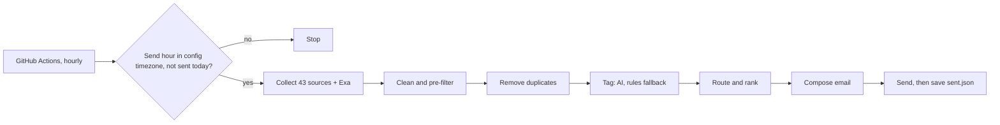

# Daily Automotive Sales Signals

Case 1: Daily Industry Intelligence Report · Workflow design, explanation and assumptions · 15 Nov 2026

---

## At a glance

A daily automotive news digest is easy to build and easy to ignore. What a business development team needs at 8:00 AM is narrower: what changed at the companies we sell to, and where a new opportunity opened yesterday.

So the workflow turns public automotive news into **sales signals**. Every hour a scheduled job checks the clock; at the configured send time it collects from 43 public sources (plus 8 optional Exa news searches), removes noise and duplicates, uses an AI model (with a keyword-rules fallback) to extract what happened and to whom, routes each item into a section with fixed rules, and emails one short report to the team.

| Brief requirement | How it's met | Section |
|---|---|---|
| Collect automotive information from public sources | Trade-press RSS, press releases, Federal Register, NHTSA recalls, regional business news, Google News searches, optional Exa news search | 7.1 |
| Filter duplicate or irrelevant content | Noise filter, four duplicate checks, 14-day memory of what was sent | 7.2, 7.3 |
| Summarize into a readable report | One fact and one implication per item, in five fixed sections | 7.5, 7.6 |
| Send to a specified email address | Recipients listed in `config.yaml`; any address works | 7.7 |
| Run every day at 8:00 AM | Hourly check that sends once, at the local send hour, with retries | 7, 8 |
| Reliability and maintainability | No single failure stops the run; sources, keywords and thresholds are config | 8, 9 |

| Deliverable | Where |
|---|---|
| Workflow design, explanation and assumptions | This document |
| Source code | `signals.py`, `config.yaml`, `rules.yaml`, `.github/workflows/daily.yml` |
| Setup and execution instructions | `README.md` |
| Sample report | `samples/`, built from live feeds |
| Demo | Short video |

No credentials are in the repository. They're read from GitHub secrets or a local `.env`; `.env.example` lists them with placeholders.

---

## 1. Problem

### Context

I assumed the team sells automotive retail software (dealer-management and retail platforms) to carmakers, distributors and dealer groups. In that market:

- **Deals are long and sticky.** Switching a dealer-management system is painful, so contracts run for years. Buying windows open around specific events: an acquisition, a new CIO, a competitor outage, an OEM changing how it sells.
- **Being early matters.** The rep who reaches a company in the week after such an event gets onto the shortlist. A rep who hears about it a month later usually doesn't.
- **The news exists, but it's scattered.** These events are announced publicly, across dozens of trade sites, wires and regional outlets, mixed in with reviews, motorsport and car launches.

How the same news matters differs by region, which shaped the source list and the signals:

| Region | What drives buying windows | What that means for the report |
|---|---|---|
| North America (primary) | Dealer groups grow by acquisition; competitor incidents reopen vendor choices | Acquisitions, competitor news and leadership changes come first |
| UK and Europe | Shifts between agency and dealer models; new Chinese brands building networks with no incumbent system | OEM retail strategy and market entries |
| India | OEMs often choose the software their dealers use | The sale starts at the OEM, so OEM strategy and certifications matter |
| Middle East | A few family distributors hold many brands | Distributor appointments are close to leads in themselves |
| China, Japan, Korea | Decisions are made at OEM headquarters | Track OEM strategy rather than prospect dealers |

### Problem statement

Reps spend hours scanning news that rarely connects to their accounts, and still miss or find late the few events that open a buying window.

---

## 2. Goals and non-goals

### Goals

1. **Fast:** a buying-window event reaches the team within a day of being published.
2. **Accurate:** items are real and relevant, so a rep can act without re-checking. A wrong item costs more trust than a missed one.
3. **Short:** the email can be read in two minutes. Each item says what happened and what it typically means.
4. **Dependable:** it arrives every morning, and when something breaks the team still gets a report and the owner gets an alert.
5. **Cheap and easy to change:** close to zero running cost, and routine changes (recipients, sources, keywords) need no developer.

### Non-goals for v1

- Not a general news digest. The brief's topics are folded into signals instead of a news section (section 4).
- Not personalized per rep, because the system doesn't know account ownership (section 3).
- Not advice on when or how to act. That's the rep's judgment.
- Not a CRM, lead-scoring tool, real-time alert system or dashboard.
- No paywalled content, scraping, or republishing of full articles.

---

## 3. Users

### Who reads it

| | Key account managers | Outbound reps |
|---|---|---|
| Goal | Grow and protect existing customers | Win new customers |
| What they need to know | Changes at their customers and the brands those customers sell | Companies that just gained a reason to talk to us |
| Main problem today | Changes at customers go unseen until a renewal or a lost deal | No timely reason to reach out, and hours spent finding one |
| Sections they use most | Potential risk, Potential growth | New business |

### Who I considered and left out

- **Sales leaders** want a market backdrop. The Industry development section covers that briefly, but the report isn't designed around them, because a leader view would need team structure the system doesn't have.
- **OEM and alliances managers** are served by the brand signals (OEM strategy, certifications, launches) through the watchlist, rather than a separate report.

### One report, not one per rep

The system doesn't know who owns which account. Per-rep reports would depend on every rep maintaining their own list, which in practice decays within weeks. So v1 sends **one email to the whole team**, with an optional shared **watchlist** of clients and the brands they sell. News about watched names goes into dedicated risk and growth sections, so account managers find their accounts at the top. Per-rep reports come later, from CRM ownership data.

---

## 4. Problems prioritized into signals

I listed the events that open or close a buying window and scored each on three things: how directly it leads to a sales conversation, how often it happens, and how reliably free public news catches it.

| Event | Sales value | Frequency | Caught by public news | Decision |
|---|---|---|---|---|
| Acquisition or ownership change | High | Weekly | High | Include |
| Market entry or distributor appointment | High | Weekly | High | Include |
| Competitor incident (outage, breach, price change) | High | Occasional | High | Include |
| Leadership change (CIO, head of digital) | High | Weekly | Low to medium; mid-level hires are mostly on LinkedIn | Include, expect gaps |
| OEM DMS certification | High | Occasional | High | Include |
| New store, closure or lost franchise | Medium | Weekly | Medium | Include |
| Competitor selected by a dealer group | Medium | Occasional | Medium | Include |
| Tech investment | Medium | Occasional | Medium | Include |
| OEM retail strategy | Medium | Occasional | High | Include |
| Sales shift, launches, major recalls, regulation | Low to medium; context more than leads | Daily | High | Include, lower in the email |
| Job postings (buying intent) | Medium | Daily | Needs a jobs source | P1 |
| SEC filings for listed groups | High accuracy | Occasional | High | P1 |
| Monthly sales PDFs (FADA, SIAM, ACEA) | Low | Monthly | Needs PDF parsing | Later |
| Social posts (LinkedIn, X, Reddit) | Medium | Daily | Paid, restricted or forbid scraping | Excluded |

The included events become fourteen signals in three groups:

| Kind | Signals |
|---|---|
| **Company** | Acquisition or ownership change · Closure or lost franchise · New store · Market entry or distributor appointment · Competitor selected · Leadership change · Tech investment |
| **Brand** | OEM DMS certification · OEM retail strategy · Major recall · Sales shift · New model or EV launch |
| **Market** | Competitor incident · Regulation or policy change |

The brief's topics map onto them: market trends → sales shift and OEM retail strategy; product launches → new model or EV launch; company announcements → the company signals; other developments → recalls, regulation and competitor news.

"Us" and "competitors" (for example CDK, Reynolds and Dealertrack) are defined in `rules.yaml`, so the system can tell a rival's news from ours. For acquisitions the tagger extracts **who bought whom**, because it reverses the meaning: a client buying stores is growth, a client being bought is a risk.

---

## 5. Options considered

| | Approach | Running cost | Accuracy | Value to sales |
|---|---|---|---|---|
| A | RSS feeds, keyword match, email the headlines | Free | Low | Low; still a news list |
| B | A, plus an AI model that tags signals and companies and writes the summary | Cents a day | Good, with guardrails | Medium to high |
| C | B, plus structured sources (recalls, Federal Register, press releases) and a watchlist | Cents a day, more setup | High | High |
| D | Paid news and intent-data feeds | Hundreds to thousands a month | High coverage | High, but overlaps C |

A is what most people build first, and it fails the real problem: it moves the scanning from websites to the inbox. D suits a large team with budget, but is hard to justify before reps have shown they use the report.

**Chosen: C, using free sources only.** The AI is what turns news into signals; the structured sources are the most accurate inputs available; and it leaves a clear upgrade path (CRM for the watchlist, a paid source for any thin region).

---

## 6. Key decisions and trade-offs

| Decision | Chosen over | Why | Gave up | Reconsider if |
|---|---|---|---|---|
| One email for the whole team | Per-rep reports with profiles | No account-ownership data; self-maintained lists decay | Each rep sees items outside their territory | CRM ownership data becomes available |
| One optional shared watchlist | Separate client and brand lists, or none | One list keeps configuration simple and still enables risk and growth sections | A name's role (company or brand) is inferred per story | Matching errors show up in the pilot |
| AI extracts facts; code decides the section | Letting the AI write the whole report | The email's structure stays predictable and every rule is testable | Some nuance the AI might catch | Reps find routing too rigid |
| AI with a keyword-rules fallback | Rules only, or AI only | Rules alone miss paraphrases; AI alone makes the report depend on one API | Rule-tagged items are less precise | Labelled accuracy shows rules are nearly as good, so AI isn't paying for itself |
| Duplicate detection by headline similarity and same-signal-same-company | Embeddings | Free, no extra API call, enough at a few hundred items a day | Some paraphrased duplicates slip through | Over 5% of report items are duplicates |
| Python script on GitHub Actions | Hosted web app, n8n, Zapier or Make | Nothing to host or log into; free scheduling at this volume; logic is easier to test in code | No UI for non-developers; edits are made in GitHub | Day-to-day owners aren't comfortable editing YAML in GitHub |
| A `sent.json` file committed by the job | A database | Enough to remember what was sent; no extra service | No run-history queries | Reporting or per-rep state is needed |
| Hourly check of local time, not a fixed cron | One daily cron | GitHub cron is UTC only; the hourly check handles any timezone and daylight saving, and gives free retries | About 720 short runs a month | A scheduler with timezone support is adopted |
| SMTP with a Gmail app password | A transactional email service | Works for any recipient immediately, no domain verification | Weaker deliverability at scale | A sending domain is available |
| Free public sources | Paid news APIs | Covers the high-value signals well enough for a pilot | Thinner coverage outside North America, India and the UK | A priority region turns out thin |

### What I cut to reach an MVP

An earlier design had per-rep profiles, a web app with login, a run-history screen, a Postgres database and "Acted on this / Not useful" links. Checked against the brief, none of them is needed to meet the five requirements, and each added hosting, credentials or data that the team would have to maintain. They were cut or moved to P1 (section 11), which made the build one script and two config files.

---

## 7. How the workflow runs

A GitHub Actions job runs `signals.py` every hour at :17 UTC. It does real work only when it's the send hour in `config.yaml`'s timezone and today's email hasn't gone out. Changing the time, the timezone or daylight saving needs no edit to the schedule. The rule throughout: one bad source, item or API call never stops the run.

### 7.1 Collect

43 sources from `rules.yaml`, fetched in parallel with a timeout and retries:
- trade-press RSS (for example CBT News, Automotive Dive, Motor Trader, Canadian Auto Dealer, Autocar Professional)
- press releases (PR Newswire), the Federal Register (NHTSA, FTC) and SMMT
- the NHTSA recalls dataset, filtered to recalls affecting 10,000+ vehicles
- regional business news (BusinessLine, Yonhap, The Korea Herald, The Japan Times, Khaleej Times)
- 13 Google News searches, one per signal
- optional: 8 Exa news searches for the high-value company signals (acquisition, new store, market entry, leadership change, competitor selected, tech investment, OEM retail strategy, competitor incident). They run only when `EXA_API_KEY` is set, return the publisher's own link instead of a Google redirect, and include a few sentences from the article, which gives the tagger more than a headline to work with. Cost is about $0.01 per search, so roughly $2–3 a month at one run a day plus test runs.

It covers everything since the last email: 24 hours normally, up to 72 after a missed day. Only headlines, feed summaries and Exa's short highlights are used; nothing is republished.

### 7.2 Clean and pre-filter

Links are normalized and tracking parameters removed; HTML is stripped; dates are put in UTC. A keyword filter then drops noise before any AI call: reviews, motorsport, "best SUVs" lists, deals, spy shots and multi-story digests. Items from general-news feeds must also look automotive. Names that only contain a car brand ("HD Hyundai", a shipbuilder) don't count.

### 7.3 Remove duplicates

1. The same link.
2. The same story from another outlet: normalized headlines compared within two days (similarity 0.75).
3. After tagging, the same signal about the same companies within two days, for headlines too different to match by words.
4. Anything already emailed in the last 14 days, kept in `sent.json`.

From each group the most credible source is kept: press release or official source, then trade press, then general news.

### 7.4 Tag

With an Anthropic API key, Claude Haiku 5.5 reads stories in batches of 20 and returns, in a fixed format: the signal; the companies and their roles (buyer, bought, subject, certified); the brands; a factual summary; a separate implication; and a confidence score. Every company or brand it returns is checked against the article text, which catches the most common invented detail. If a batch fails or there's no key, keyword rules from `rules.yaml` tag that batch instead.

### 7.5 Route and rank

Routing is deterministic code (`ROUTING` in `signals.py`). A watchlist name counts as a **watched company** when the story is about that company, and a **watched brand** when it's about that vehicle brand. "—" means the next column decides.

| Signal | Watched company | Watched brand | Not on the watchlist |
|---|---|---|---|
| Acquisition or ownership change | Buyer: **Potential growth**. Bought: **Potential risk** | — | **New business** |
| Closure or lost franchise | **Potential risk** | — | **Lower priority** |
| New store | **Potential growth** | — | **New business** |
| Market entry or distributor appointment | **Potential growth** | — | **New business** |
| Competitor selected | **Potential risk** | — | **Lower priority** |
| Leadership change | **Potential risk** | — | **New business** |
| Tech investment | **Potential growth** | — | **New business** |
| OEM DMS certification | — | Competitor certified: **Potential risk**. We're certified: **Potential growth** | We're certified: **New business**. Otherwise: **Industry development** |
| OEM retail strategy | — | **Potential growth** | **Industry development** |
| Major recall | — | **Potential growth** | Not shown |
| Sales shift | — | Rising: **Potential growth**. Falling: **Potential risk** | **Industry development** |
| New model or EV launch | — | **Potential growth** | **Industry development** |
| Competitor incident | **Industry development** | **Industry development** | **New business** (the competitor's customers) |
| Regulation or policy change | **Industry development** | **Industry development** | **Industry development** |

Without a watchlist, only the last column applies. Two rules sit on top:
- **Confidence gate.** Only items with confidence of 0.7 or more go into Potential risk, Potential growth or New business; the rest drop to Industry development.
- **Priority.** A company with two or more stories in 30 days is marked Priority and listed first. Vehicle brands are excluded, since they're in the news daily.

Within a section, items are ordered by Priority, then confidence, source credibility, number of outlets and recency.

### 7.6 Compose

| Section | Appears when | Items shown |
|---|---|---|
| Potential risk | A watched name is in the news | All |
| Potential growth | A watched name is in the news | All |
| New business | Always | Top 5 |
| Industry development | Always | Top 3 |
| Lower priority | Always | Top 3 |

Each item is the fact with its source linked, then the implication on its own line. Empty sections are left out; a quiet day sends one line, because a missing email looks like a broken workflow. HTML and plain-text versions are built.

> **Subject:** Automotive market summary – Friday, 14 November
>
> Good morning,
>
> Please find below the automotive developments from the past 24 hours that are relevant to our accounts and markets.
>
> **Potential risk**
> - Dealer Group B has appointed a new Chief Information Officer, previously with a competing group. Dealer Group B is on your watchlist. ([Trade Publication](https://example.com/1))
>   *Implication: incoming CIOs frequently review existing vendor relationships.*
>
> **New business**
> - Priority: Dealer Group C has agreed to acquire a five-store group, its second acquisition this month. ([Trade Publication](https://example.com/3))
>   *Implication: groups expanding at this pace typically reassess how their stores are managed.*
>
> **Industry development**
> - New consumer data regulations for dealers take effect in January. ([Trade Publication](https://example.com/4))

*Companies, events and links are placeholders. Real output is in `samples/`.*

### 7.7 Send and save

The email goes out over SMTP to every address in `config.yaml`. The job then commits `sent.json`, recording the day as sent and the stories included. From the Actions tab, **Run workflow** can build a preview (attached to the run, nothing sent) or send now, optionally to one test address that doesn't count as the day's email.

---

## 8. Reliability

| Failure | What happens | What the team sees |
|---|---|---|
| A source is down or returns garbage | Retried, then skipped and logged | Slightly less coverage |
| Most sources fail | The email still goes out | A "Coverage was partial today" line |
| AI down or malformed output | Retry once, then rules for that batch | The same partial-coverage line |
| AI names a company not in the article | That item is tagged by rules | Nothing |
| Sending fails | The job fails; hourly retries for up to 3 hours after the send time | A late email |
| Scheduler misses a run or runs twice | The next run catches up; `sent.json` blocks a second send | Nothing |
| Bad config (email, hour, timezone) | Validated at start-up; fails before fetching | Owner alert |

**Alerts:** a failed run fails the GitHub Actions job, and GitHub emails the repository owner. Each run's log shows counts at every stage and which sources failed.

---

## 9. Maintainability

| Change | Where | Developer needed? |
|---|---|---|
| Recipients, send time, timezone, watchlist | `config.yaml` | No |
| Add or remove a source | One entry in `rules.yaml` | No |
| Our company, competitors, noise and signal keywords | `rules.yaml` | No |
| Thresholds and caps | `rules.yaml` | No |
| Turn AI on or off | Add or remove the `ANTHROPIC_API_KEY` secret | No |
| Turn Exa searches on or off, or change their queries | The `EXA_API_KEY` secret; queries are entries in `rules.yaml` | No |
| Which section a signal goes to | `ROUTING` in `signals.py` (mirrors 7.5) | Yes |

Both YAML files can be edited in GitHub's browser editor. Tests in `tests/` run on saved real feeds with no network and no email, covering what breaks quietly: link normalization and duplicate grouping, every cell of the routing table, the confidence gate, Priority and caps, the keyword rules including who bought whom, the AI response check and fallback, and the schedule (not before the send hour, once a day, retries, no repeats). Each stage is a separate function, so it maps onto workflow-tool nodes if a no-code version is ever preferred.

---

## 10. Success metrics

**North star: pipeline created from report items.** Reps set the CRM opportunity source to "Signals report" when an item leads to a conversation. The targets are hypotheses for the pilot.

| Metric | Hypothesis |
|---|---|
| Opportunities sourced from the report | At least one per rep per month |
| Time spent on news research (survey before and at 30 days) | Down 50% |
| Days from event to first contact | Shorter than before launch |
| "Useful" rating in the 30-day survey | 4 out of 5 or better |

| Guardrail | Target |
|---|---|
| Tagging accuracy, labelled sample of 100 items | 80% or better, with rules-only accuracy reported alongside |
| Duplicates in a sample of emails | Under 5% |
| Delivered within 30 minutes of send time | 99% of days |

---

## 11. Priorities

| Priority | What | Why here |
|---|---|---|
| **P0 (built)** | Hourly schedule, once-a-day send at a local time · 43 sources plus optional Exa searches · noise filter and duplicate removal · AI tagging with rules fallback · routing table, confidence gate, Priority and caps · optional watchlist · one email to all recipients · GitHub failure alerts · preview and test-send | The minimum that meets all five requirements reliably |
| **P1** | "Acted on this / Not useful" links (needs a small web endpoint) · SEC filings for listed dealer groups · job postings as a buying-intent signal · resolving Google News redirect links to publisher URLs | Improves measurement and accuracy once the report is in use |
| **Later** | Per-rep reports from CRM ownership · paid source for thin regions · non-English sources · Slack or Teams delivery · monthly sales data | Depends on CRM access, budget, or proof of use |

---

## 12. Assumptions

1. The team sells retail software to carmakers, distributors and dealer groups. A different audience changes the signals and keywords, not the pipeline.
2. North America is the primary market; other regions are expansion territory.
3. The whole team gets the same email; account ownership would come from the CRM in production.
4. 8:00 AM means the timezone set in `config.yaml` (America/Chicago by default). The report runs every day, including weekends; each email covers the time since the last one.
5. Only free, public, English-first sources are used. Items are summarized from headlines and feed summaries and link to the original.
6. The report says what an event typically means. When and how to act is the rep's call. Nothing is sent to customers or prospects.
7. Volumes stay modest: a few hundred raw items a day and a team-sized recipient list.
8. Thresholds (headline similarity 0.75, confidence gate 0.7, caps) are starting guesses in `rules.yaml`, to be replaced with measured values.
9. The sending account is Gmail or Google Workspace with 2-step verification, so it can use an app password.
10. Credentials live only in GitHub secrets or a local `.env`.

---

## 13. Risks and open questions

- **Misclassified items.** The first live sample shows the kinds of error to expect: a story about fake recall notices tagged as a recall, and a certified-used programme tagged as a launch. The labelled accuracy check and keyword tuning in week 0 address this; the confidence gate limits the damage by keeping weak tags out of the top sections.
- **Google News links.** These point to Google redirects rather than publishers, which makes links long and weakens link-based duplicate checks. Headline matching covers duplicates for now; Exa results already carry publisher links, and resolving Google's is P1.
- **Thin snippets.** Google News summaries are often the headline repeated, so tagging is less accurate. Trade-press and press-release versions are preferred where they exist, and Exa results include sentences from the article itself.
- **Company-name matching.** "Group 1" is a dealer group and an ordinary phrase; "Ford" appears in stories that aren't about Ford. Aliases, brand exclusions and the AI's company extraction help, but this is where false matches are most likely.
- **Leadership changes are under-covered,** since most hires below C-level appear only on LinkedIn.
- **Open question for the team:** is one shared report enough, or do reps need their own? The pilot survey answers this before any per-rep work starts.

---

## 14. Rollout

| When | What |
|---|---|
| Week 0 | Run on live feeds for a few days in preview mode; hand-label 100 items; measure accuracy and duplicates; tune keywords and thresholds |
| Week 1 | Pilot with 3 to 5 reps across account management and outbound; baseline survey on research time |
| Weeks 2 to 4 | Adjust sources, keywords and caps from feedback; add the feedback links (P1) |
| Day 30 | Survey again; review opportunities sourced; decide on wider rollout and CRM integration |

Sales operations owns `config.yaml` (recipients and watchlist); whoever maintains the report owns `rules.yaml`; failure alerts go to the repository owner.

---

## 15. Cost

GitHub Actions: about one minute per run, roughly 720 minutes a month, free on public repositories and within the 2,000 free minutes for private ones. AI tagging of around a hundred items a day with a small model costs cents a day. Gmail SMTP is free at this volume. Total: roughly $0 to $3 a month.
