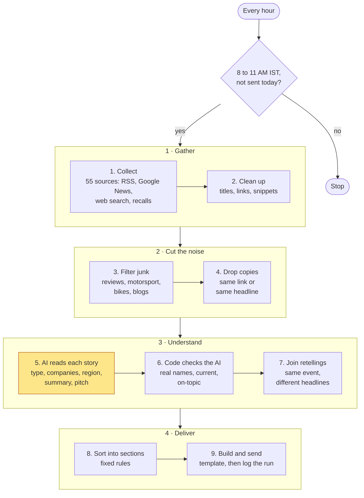

# Daily Automotive Sales Signals: workflow design

## 1. Assumptions

1. The readers are a business development team in India, selling Tekion's dealer software to dealers, dealer groups, distributors and carmakers worldwide. The email arrives at 8:00 AM IST.
2. One email goes to one address, which can be a team list.
3. Each email covers the time since the last one, up to 72 hours, so a missed day isn't lost.
4. Only free, public, English sources are used. Each story is summarised from its headline and snippet and links to the original.
5. News from every region is included, and each story shows where it happened.
6. There's no access to the CRM, so we don't know which rep owns which account. The email informs; when and how to act is the rep's call.

## 2. Personas

A DMS (dealer management system, the core software a dealership runs on) takes months to sell and locks a dealer in for years. So a dealer only looks at new software at certain moments: a new store, an acquisition, a new leader, or a bad experience with its current vendor. The rep who shows up at that moment gets onto the shortlist.

| Persona | Their job | What they do every day |
|---|---|---|
| **BDR (business development rep)**, the primary reader | Win dealers and groups that aren't customers yet | Builds lists, looks for a reason to reach out, books first meetings |
| **KAM (key account manager)** | Keep and grow existing customers | Watches their accounts for expansion and churn risk |
| **Sales leader** | Hit the number across the team's territories | Reviews pipeline, decides where the team focuses |

## 3. Problems and solutions

P0 problems cost deals; P1 problems cost time or a later deal.

| Persona | Priority | Problem | Solution |
|---|---|---|---|
| **BDR** | P0 | **Late to buying moments:** hears about a new store or acquisition after a competitor has called | A **Sales signals** section every morning: acquisitions, new stores, market entries, leadership changes, tech investment, dealers picking a competitor |
| | P0 | **Signal buried in noise:** hours of reading, mostly repeats, reviews and motorsport | 55 sources in one email; junk filtered, repeats removed, off-topic or old stories dropped; one line per story |
| | P0 | **No opening:** doesn't know which Tekion product to lead with | A **Pitch** under each sales signal: the need the event creates and the product that meets it |
| | P1 | **Can't see where:** stories from every country mixed together | The region on every story |
| **KAM** | P0 | **Account changes found too late:** learns of an acquisition or new owner at renewal | Their customers appear in Sales signals whenever they're in the news |
| | P0 | **Blind to competitor moves:** misses a peer picking CDK or a competitor's outage | A **Competitors** section, plus "dealer picks a competitor" in Sales signals |
| | P1 | **Expansion moments missed:** new stores at a customer | New stores and acquisitions in Sales signals |
| | P1 | **Carmaker changes unseen:** software approvals, sales-model changes, big recalls | **Industry trends** |
| **Sales leader** | P0 | **Market shifts unseen:** sales trends, new rules, changes in how carmakers sell | **Industry trends at the top**: up to 10 stories, mixed so one topic can't take over |
| | P0 | **Competitor tracking is manual** | The same Competitors section |
| | P1 | **No view of follow-through:** which signals the team acted on | Not in the first version; needs feedback links or the CRM |

The email has four sections, in order: **Industry trends, Sales signals, Competitors, Tekion**. Each story is one line, "Company · Region – summary (outlet link)", with a Pitch under each sales signal. Nothing is marked as a priority; reps decide.

## 4. Trade-offs

### One shared email, not one per rep

A personal email for each rep sounds better. We chose one shared email because:

1. **We have no source of truth for who owns what.** That lives in the CRM. Lists typed in by reps go out of date within weeks.
2. **An out-of-date filter quietly hides deals.** A shared email shows too much, which costs a few seconds of skimming. A wrong filter hides a buying moment, which costs a deal, and the rep never knows.
3. **One email is easy to maintain, and the door stays open.** One set of settings, one thing to check. Every story already carries its type, companies and region, so per-rep filters can be added once the CRM is connected.

So instead of filtering, we **label**: every story shows its company and region, and a rep finds their own in seconds.

### Other trade-offs

| Decision | Why | What we give up |
|---|---|---|
| **Global news labelled by region**, not one email per region | A label never goes out of date; territories do | A longer email |
| **No watchlist of existing accounts** | Without the CRM, KAMs keep the list by hand, and an out-of-date list hides the news they most need | No "your customer was just acquired" alert until the CRM is connected |
| **Nothing marked Priority** | Reps know their own territory better than a score does | No "start here" pointer |
| **AI reads each story**, not keyword rules | When keyword rules took over in one real run, years-old articles and a kitchen showroom got through | If the AI service is down, fewer stories get through |
| **Leave out what the AI can't read**, rather than guess | Better to miss a story than send a wrong one | Fewer stories on a bad day |

## 5. Workflow design

The workflow has four stages. Only one box uses AI (yellow); everything else is fixed rules in code.

| Step | Rules or AI | In one line |
|---|---|---|
| Trigger | Rules | Checks every hour; sends once a day, between 8 and 11 AM IST |
| 1. Collect | Rules | Pulls the last day's stories from 55 sources |
| 2. Clean up | Rules | Tidies titles, links and snippets |
| 3. Filter noise | Rules | Throws out stories that are clearly not business news |
| 4. Drop copies | Rules | Keeps one copy when the same link or headline appears more than once |
| 5. Read and tag | **AI** | Decides what each story is about and writes the summary and pitch |
| 6. Check the AI's work | Rules | Rejects anything the AI got wrong or made up |
| 7. Join retellings | Rules | Joins stories about the same event whose headlines are too different for step 4 |
| 8. Sort into sections | Rules | Puts each story in a section and orders it |
| 9. Build and send | Rules | Fills the email template and sends it over SMTP. **This build uses Brevo**; any SMTP provider works instead, such as the company's own mail server, or Gmail or Microsoft 365 with an app password |

The AI is good at reading and judging ("is this news or a car review?"); rules are good at decisions that must always come out the same ("which section does an acquisition go in?"). So the AI reads, and the code decides.

**When something fails:**

| What goes wrong | What happens | What the reader sees |
|---|---|---|
| A source is down or slow | Tried twice more, then skipped | Nothing. If more than 60% of sources fail, the email says "Coverage was partial today" |
| An AI batch fails | Tried again, then split in half and tried again; anything still unread is left out and logged | "Coverage was partial today" at the top |
| The AI names a company the article doesn't mention | That story is left out | Nothing |
| No AI key | Keyword rules sort every story instead | Headlines instead of AI summaries |
| The 8 AM run is late or fails | The next hourly check tries again, until 11:00 IST | The email arrives a little later |
| The whole job crashes | Logged as failed; GitHub emails the repo owner | No email that day |

**What can be changed without touching code:** recipients, send time and timezone (in `config.yaml`); sources, competitors, Tekion products, junk filters and section limits (in `rules.yaml`); passwords and keys (in GitHub's secret settings).

## 6. Metrics

The targets are our best guesses, to be checked in a 4-week pilot. The north star is how often a sales signal turns into a call or email from a rep, because the email exists to start conversations.

| Type | Metric | Target | How we measure it |
|---|---|---|---|
| **North star** | Share of sales signals a rep acted on | 20% or more | A one-question weekly survey in the pilot ("Which items did you follow up on?") |
| **Adoption** | Reps who open the email | 70% or more of working days | Open tracking from the email provider |
| **Outcome** | Sales pipeline started from stories in these emails | Grows month on month | **Can't be tracked yet.** Each new opportunity in the CRM would need to be linked to the story that started it. Until then, the north-star survey stands in |
| **Guardrails** | AI cost per email | Low enough to ignore | The Claude usage dashboard, divided by emails sent |
| | Days with no email (a failed run) | Zero | The run log, and GitHub's failure alert |

**What would change our mind:** if reps open the email but rarely act on it, tighten what counts as a sales signal; if KAMs keep asking for news about their own accounts, connect the CRM sooner.

## 7. Source code

https://github.com/shushrut-builder/auto-news-tracker (setup and execution: [docs/setup-and-execution.md](setup-and-execution.md))
