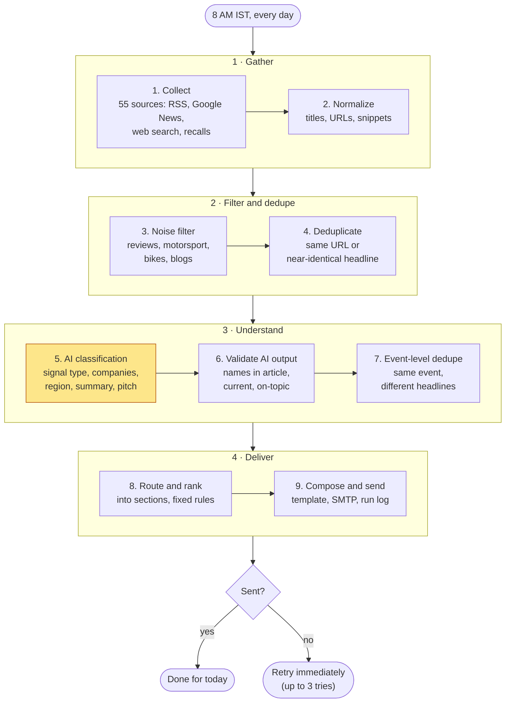

# Daily Automotive Sales Signals: workflow design

## 1. Assumptions

1. The readers are a business development team in India, selling Tekion's dealer software to dealers, dealer groups, distributors and carmakers worldwide. The email arrives at 8:00 AM IST.
2. One email goes to one address, which can be a team list.
3. Each email covers the time since the last one, up to 72 hours, so a missed day isn't lost.
4. Only free, public, English sources are used. Each story is summarised from its headline and snippet and links to the original.
5. News from every region is included, and each story shows where it happened.
6. There's no access to the CRM, so we don't know which rep owns which account. The email informs; when and how to act is the rep's call.

## 2. Personas

A DMS (dealer management system, the core software a dealership runs on) takes months to sell and locks a dealer in for years. So a dealer only looks at new software at certain moments: a new store, an acquisition, a new leader, or a bad experience with its current vendor. The rep who shows up at that moment gets onto the shortlist.

| Persona | Their job | What they do every day |
|---|---|---|
| **BDR (business development rep)**, the primary reader | Win dealers and groups that aren't customers yet | Builds lists, looks for a reason to reach out, books first meetings |
| **KAM (key account manager)** | Keep and grow existing customers | Watches their accounts for expansion and churn risk |
| **Sales leader** | Hit the number across the team's territories | Reviews pipeline, decides where the team focuses |

## 3. Problems and solutions

P0 problems cost deals; P1 problems cost time or a later deal.

| Persona | Priority | Problem | Solution |
|---|---|---|---|
| **BDR** | P0 | **Late to buying moments:** hears about a new store or acquisition after a competitor has called | A **Sales signals** section every morning: acquisitions, new stores, market entries, leadership changes, tech investment, dealers picking a competitor |
| | P0 | **Signal buried in noise:** hours of reading, mostly repeats, reviews and motorsport | 55 sources in one email; junk filtered, repeats removed, off-topic or old stories dropped; one line per story |
| | P0 | **No opening:** doesn't know which Tekion product to lead with | A **Pitch** under each sales signal: the need the event creates and the product that meets it |
| | P1 | **Can't see where:** stories from every country mixed together | The region on every story |
| **KAM** | P0 | **Account changes found too late:** learns of an acquisition or new owner at renewal | Their customers appear in Sales signals whenever they're in the news |
| | P0 | **Blind to competitor moves:** misses a peer picking CDK or a competitor's outage | A **Competitors** section, plus "dealer picks a competitor" in Sales signals |
| | P1 | **Expansion moments missed:** new stores at a customer | New stores and acquisitions in Sales signals |
| | P1 | **Carmaker changes unseen:** software approvals, sales-model changes, big recalls | **Industry trends** |
| **Sales leader** | P0 | **Market shifts unseen:** sales trends, new rules, changes in how carmakers sell | **Industry trends at the top**: up to 10 stories, mixed so one topic can't take over |
| | P0 | **Competitor tracking is manual** | The same Competitors section |
| | P1 | **No view of follow-through:** which signals the team acted on | Not in the first version; needs feedback links or the CRM |

The email has four sections, in order: **Industry trends, Sales signals, Competitors, Tekion**. Each story is one line, "Company · Region – summary (outlet link)", with a Pitch under each sales signal. Nothing is marked as a priority; reps decide.

## 4. Trade-offs

| Design choice | Options considered | We chose | Why | What we give up |
|---|---|---|---|---|
| **How it's delivered** | A web report or dashboard · a Slack post · an email | **An email** | Reps already work from their inbox, so there's no new tool to open. Nothing to host or store: no server, no database. And email is a format any tool connected to the mailbox can ingest (the CRM's email sync, an inbox AI assistant, an automation tool), so the stories can be searched and analysed further without building anything | No interactive filtering or search inside the report; the history lives in inboxes rather than one archive |
| **Who gets which stories** | One email per rep · one per region · one shared email | **One shared email, every story labelled with company and region** | Per-rep or per-region emails need a list of who owns which accounts and territories. Without the CRM, someone keeps that list by hand, it goes stale within weeks, and a stale filter silently hides a buying moment. One email has one set of settings to maintain | A longer email; each rep skims for their own region |
| **Existing customers** | A watchlist in the config · match against the CRM · none in the first version | **None in the first version** | Same maintenance problem: a hand-kept list goes out of date and hides the news KAMs most need. Customers still appear in Sales signals when they're in the news | No "your customer was just acquired" alert until the CRM is connected |
| **What to read first** | A "Priority" flag from a score · a fixed order | **A fixed order, no flag**: strongest signal type first, then source quality and how many outlets covered it, then the newest | A score can't know a rep's territory or accounts, so a flag would be wrong for most readers. A fixed order is predictable and easy to tune in `rules.yaml` | No single "start here" pointer |
| **How stories are classified** | Keyword rules · AI alone · AI checked by code | **AI, checked by code** | When keyword rules took over in one real run, years-old articles and a kitchen showroom got through. The AI judges context; code then verifies names and drops anything flagged old or off-topic | An API cost per run, and a dependency on the AI service |
| **When the AI fails on a batch** | Fall back to keyword rules · leave the stories out | **Leave them out** and say coverage was partial | Better to miss a story than send a wrong one | Fewer stories on a bad day |

**Built so the choices can change later:** every story already carries its type, companies and region, so per-rep or per-region filters can be switched on once the CRM is connected, with no change to the rest of the workflow.

## 5. Workflow design

The workflow has nine steps in four stages. Only step 5 uses AI (yellow); everything else is fixed rules in code.

| Step | Rules or AI | In one line |
|---|---|---|
| Trigger | Rules | Runs at 8 AM IST every day. Once an email is sent, nothing more that day |
| 1. Collect | Rules | Pulls stories published since the last email (24 hours, or up to 72 after a missed day) from 55 sources |
| 2. Normalize | Rules | Cleans titles and snippets, and strips tracking parameters from URLs |
| 3. Noise filter | Rules | Throws out stories that are clearly not business news |
| 4. Deduplicate | Rules | Keeps one copy when the same URL appears twice, or two headlines share 75% or more of their words within 48 hours |
| 5. AI classification | **AI** | Reads stories in batches of 12; returns the signal type, companies, region, a summary and a pitch, and flags anything off-topic, old or not in English |
| 6. Validate AI output | Rules | Drops a story if a company the AI named isn't in the article, or if the AI flagged it off-topic, old or not English. Removes a pitch that tells the rep what to do ("reach out", "should") |
| 7. Event-level dedupe | Rules | Merges stories the AI tagged with the same signal and mostly the same companies within 48 hours. Catches the same event under different headlines, which step 4 can't see |
| 8. Route and rank | Rules | Puts each story in a section and orders it |
| 9. Compose and send | Rules | Fills the email template and sends it over SMTP; if sending fails, retries immediately, up to 3 tries. **This build uses Brevo**; any SMTP provider works instead, such as the company's own mail server, or Gmail or Microsoft 365 with an app password |

The AI is good at reading and judging ("is this news or a car review?"); rules are good at decisions that must always come out the same ("which section does an acquisition go in?"). So the AI reads, and the code decides.

**When something fails:**

| What goes wrong | What happens | What the reader sees |
|---|---|---|
| A source is down or slow | Tried twice more, then skipped | Nothing. If more than 60% of sources fail, the email says "Coverage was partial today" |
| An AI batch fails | Tried again, then split in half and tried again; anything still unread is left out and logged | "Coverage was partial today" at the top |
| The AI names a company the article doesn't mention | That story is left out | Nothing |
| No AI key | Keyword rules sort every story instead | Headlines instead of AI summaries |
| Sending fails | Retried immediately, up to 3 tries 30 seconds apart. A wrong password isn't retried. If all 3 fail, the 9 and 10 AM runs are the backup | Usually nothing; at worst the email arrives an hour or two late |
| The whole job crashes | Logged as failed; GitHub emails the repo owner | No email that day |

**What can be changed without touching code:** recipients, send time and timezone (in `config.yaml`); sources, competitors, Tekion products, junk filters and section limits (in `rules.yaml`); passwords and keys (in GitHub's secret settings).

## 6. Metrics

The targets are our best guesses, to be checked in a 4-week pilot. The north star is how often a sales signal turns into a call or email from a rep, because the email exists to start conversations.

| Type | Metric | Target | How we measure it |
|---|---|---|---|
| **North star** | Share of sales signals a rep acted on | 20% or more | A one-question weekly survey in the pilot ("Which items did you follow up on?") |
| **Adoption** | Reps who open the email | 70% or more of working days | Open tracking from the email provider |
| **Outcome** | Sales pipeline started from stories in these emails | Grows month on month | **Can't be tracked yet.** Each new opportunity in the CRM would need to be linked to the story that started it. Until then, the north-star survey stands in |
| **Guardrails** | AI cost per email | Low enough to ignore | The Claude usage dashboard, divided by emails sent |
| | Days with no email (a failed run) | Zero | The run log, and GitHub's failure alert |

**What would change our mind:** if reps open the email but rarely act on it, tighten what counts as a sales signal; if KAMs keep asking for news about their own accounts, connect the CRM sooner.

## 7. Source code

https://github.com/shushrut-builder/auto-news-tracker
